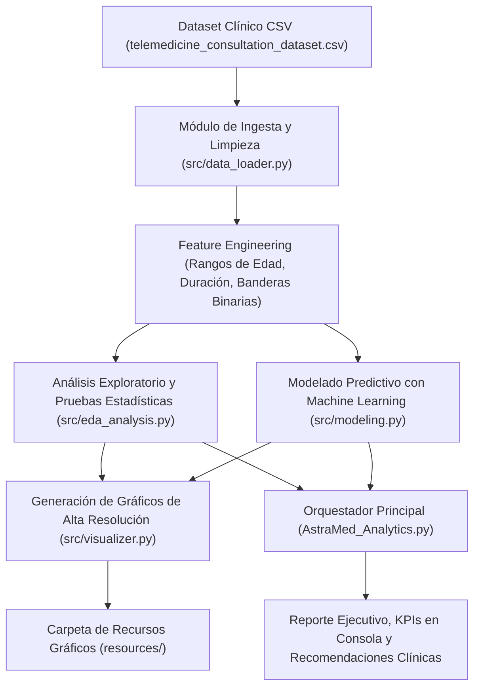
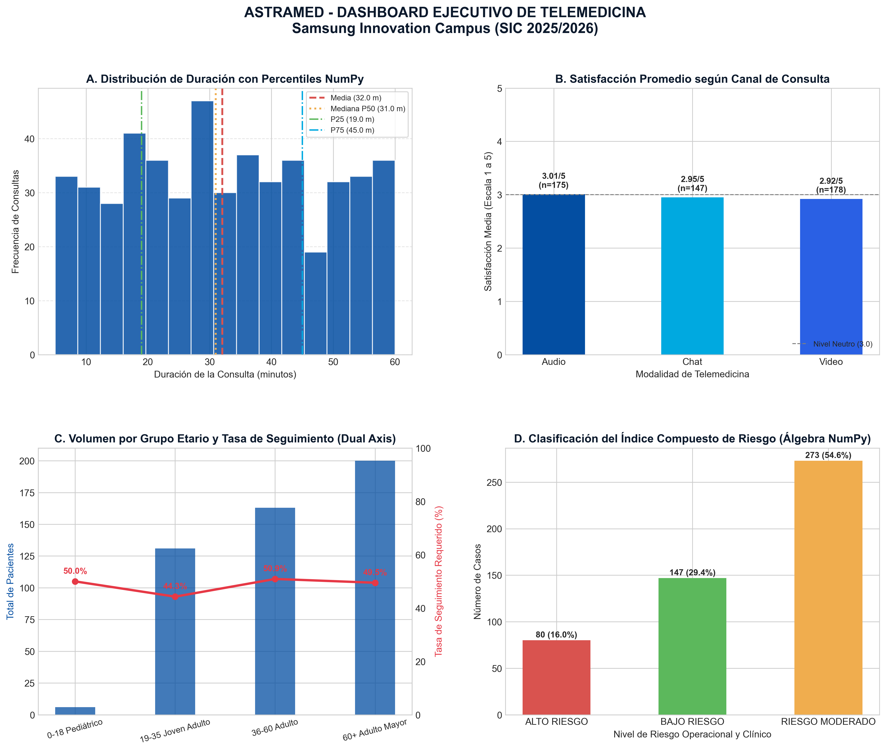
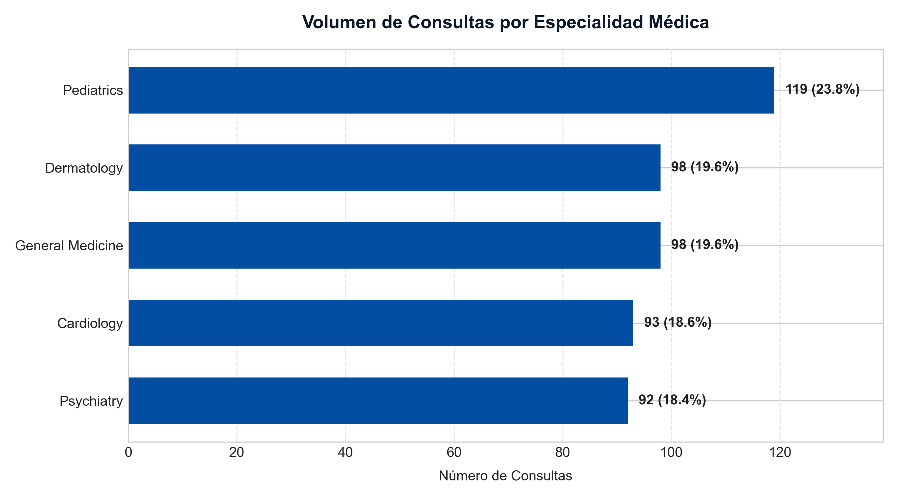
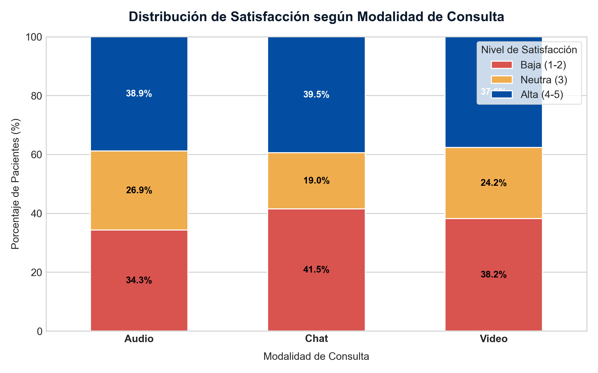
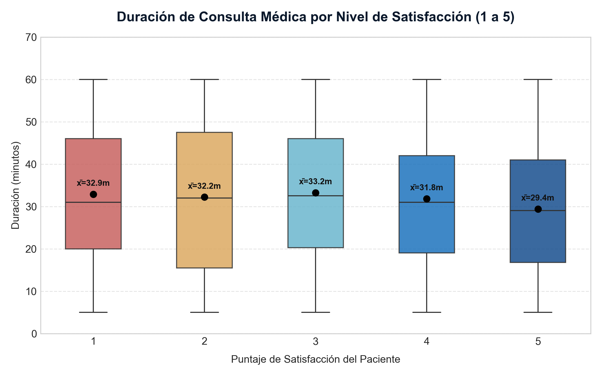
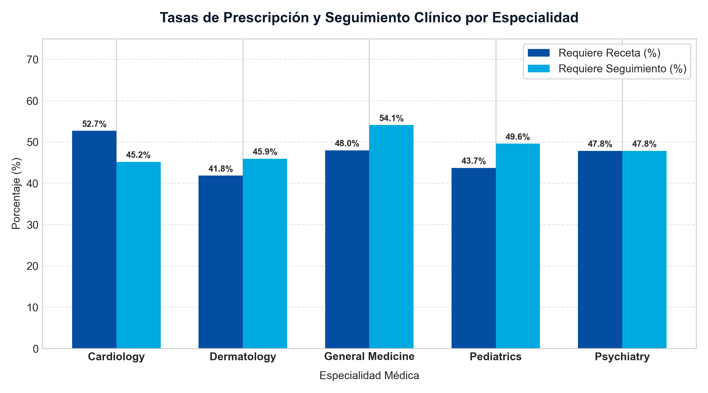
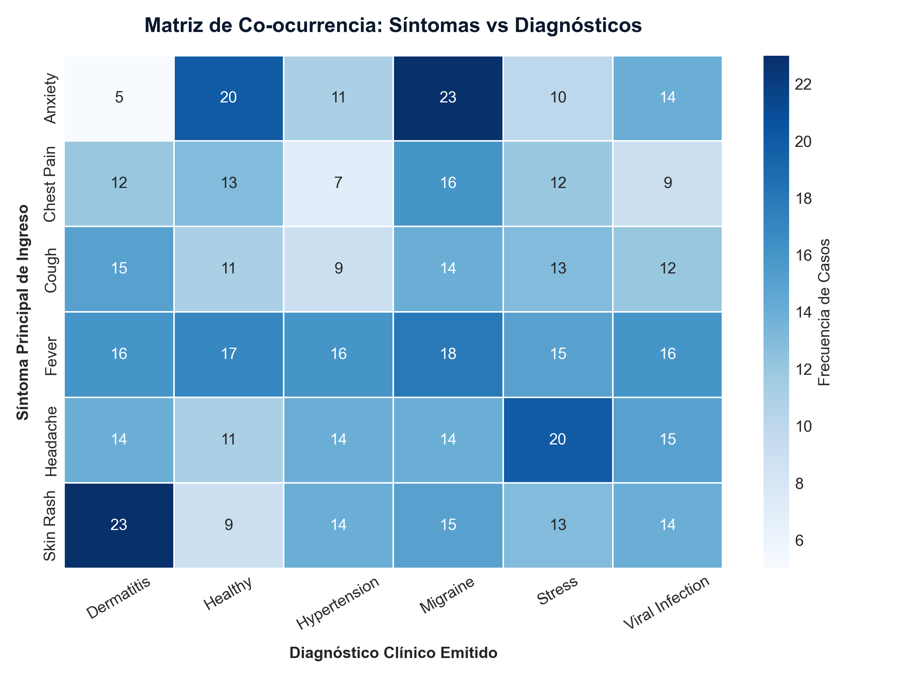
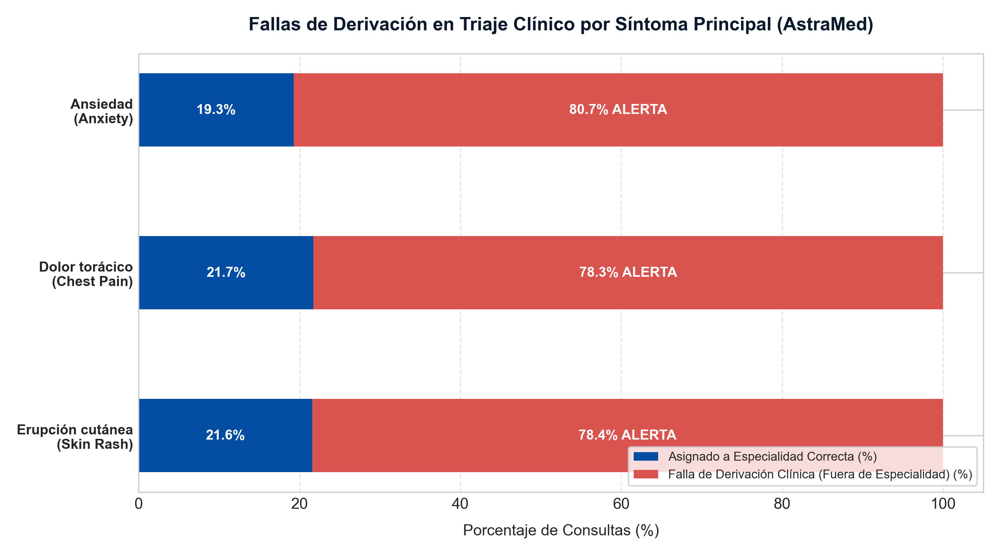
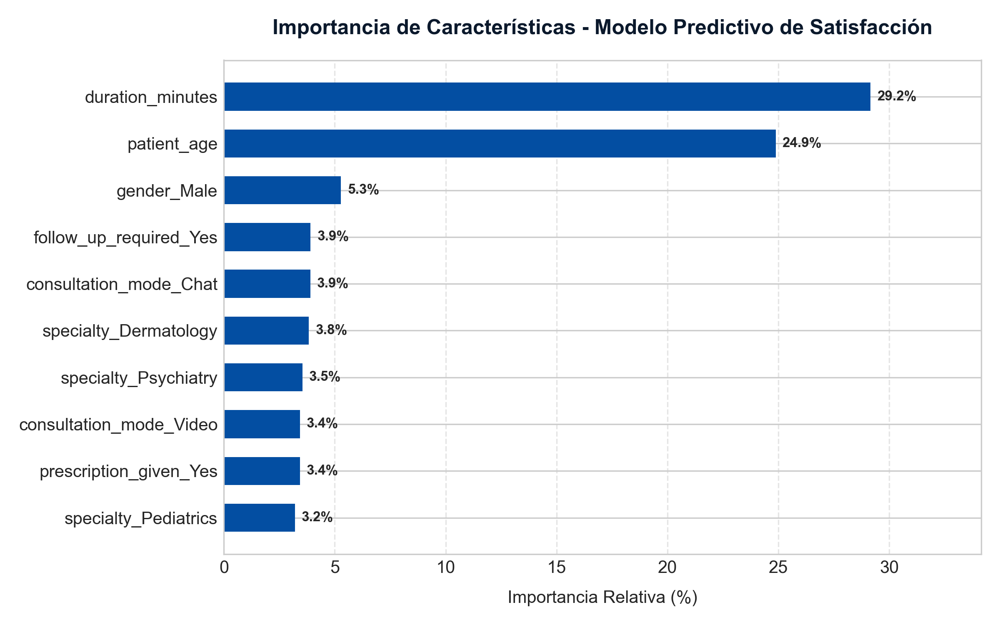

# AstraMed: Plataforma Analítica Predictiva para Telemedicina
### Samsung Innovation Campus (SIC 2025/2026) - Proyecto Final Módulo Python


---

## 📌 Planteamiento del Problema

La telemedicina ha transformado el acceso a los servicios de salud a nivel global; no obstante, centros médicos y aseguradoras enfrentan retos críticos en la **calidad percibida del servicio**, la **adherencia terapéutica** y la **asignación adecuada de canales** (Video, Audio, Chat).

A través del análisis cuantitativo de **500 consultas de telemedicina**, se detectaron los siguientes puntos neurálgicos:
* **Alta tasa de insatisfacción:** Un **37.8% de los pacientes** evalúan su experiencia de forma negativa (puntaje 1 o 2 sobre 5), con una satisfacción promedio de apenas **2.96 / 5.00**.
* **Impacto severo por demoras clínicas:** Las consultas que superan los **45 minutos** ven caer su satisfacción media a **2.74 / 5.00**, evidenciando fatiga digital y problemas técnicos.
* **Vacío en el seguimiento clínico:** El **48.6% de los pacientes requiere seguimiento obligatorio**, pero sin un mecanismo predictivo o de agendamiento automático, el riesgo de abandono de tratamiento se dispara.
* **Fricción en diagnósticos dermatológicos:** Dermatología registra la satisfacción más baja (**2.83 / 5.00**), reflejando la dificultad de evaluar patologías cutáneas sin captura estandarizada previa de imágenes.

---

## 🎯 Objetivos del Proyecto

### Objetivo General
Desarrollar una plataforma analítica y predictiva en **Python** que optimice los tiempos de atención, garantice la continuidad del cuidado médico y mejore la satisfacción global de los pacientes en servicios de telemedicina.

### Objetivos Específicos
1. **Pipeline de Ingesta y Feature Engineering:** Automatizar la limpieza, estructuración y tipado de los registros clínicos mediante Pandas y NumPy.
2. **Analítica Exploratoria y Pruebas Estadísticas:** Evaluar la relación entre especialidades, duración y canales mediante pruebas de hipótesis formalizadas (Chi-cuadrado y ANOVA).
3. **Modelado Predictivo de Machine Learning:** Entrenar algoritmos de clasificación supervisada (Random Forest) para anticipar pacientes en riesgo de insatisfacción y clasificar necesidades de seguimiento.
4. **Visualización y Soporte a Decisiones:** Generar reportes visuales de alta resolución bajo la línea gráfica oficial de Samsung y emitir directrices operacionales para gestores de salud.

---

## 🌍 Alineación con los Valores de la UNESCO y la Agenda 2030 (ODS)

El proyecto **AstraMed** fue concebido bajo el marco de la **Recomendación sobre la Ética de la Inteligencia Artificial de la UNESCO** y los Objetivos de Desarrollo Sostenible (ODS):

* **Equidad e Inclusión Social (Valor UNESCO):** Demostración empírica de que los canales telefónicos (`Audio: 3.01/5`) ofrecen la misma satisfacción que la videollamada, asegurando acceso equitativo a la salud para comunidades rurales y vulnerables sin conectividad de alta velocidad.
* **Transparencia y Explicabilidad Algorítmica (Ética IA UNESCO):** Rechazo de modelos opacos tipo "caja negra". El modelo supervisado expone de forma transparente la importancia de cada variable (duración: 29.15%, edad: 24.89%) para auditoría médica.
* **Derecho a la Salud y No Abandono (ODS 3 - Meta 3.8):** Salvaguarda la continuidad asistencial del **48.6%** de pacientes que requieren seguimiento, reduciendo complicaciones y reingresos a urgencias.
* **Reducción de Desigualdades (ODS 10):** Descentralización del acceso a 5 especialidades médicas (Cardiología, Dermatología, Psiquiatría, Pediatría, Medicina General).
* **Acción por el Clima (ODS 13):** Disminución de la huella de carbono asociada al transporte vehicular mediante teleconsultas resolutivas.

---

## 🏗️ Arquitectura y Flujo de Datos



---

## 🛠️ Stack Tecnológico y Herramientas

* **Lenguaje:** Python 3.13 / 3.14
* **Procesamiento de Datos:** Pandas 3.1+, NumPy 2.3+
* **Machine Learning & Modelado:** Scikit-Learn 1.9+ (Random Forest Classifier, Logistic Regression, train_test_split, classification_report)
* **Estadística Inferencial:** SciPy 1.18+ (stats.chi2_contingency, stats.f_oneway)
* **Visualización de Datos:** Matplotlib 3.10+, Seaborn 0.13+ (Paleta corporativa Samsung `#034EA2`)

---

## 📁 Estructura del Repositorio

Siguiendo las directrices del programa Samsung Innovation Campus:

```text
Proyecto 1 - Telemedicina/
├── resources/                             # Gráficos y recursos visuales generados en alta resolución
│   ├── 00_dashboard_ejecutivo_multipanel.png # Canvas Matplotlib GridSpec 2x2
│   ├── 01_distribucion_especialidades.png
│   ├── 02_satisfaccion_por_modalidad.png
│   ├── 03_duracion_vs_satisfaccion.png
│   ├── 04_seguimiento_por_especialidad.png
│   ├── 05_matriz_sintoma_diagnostico.png
│   ├── 06_importancia_caracteristicas.png
│   └── 07_coherencia_triaje_especialidad.png
├── src/                                   # Arquitectura modular de código Python
│   ├── __init__.py
│   ├── data_loader.py                     # Ingesta, validación y feature engineering con Pandas
│   ├── numpy_analytics.py                 # Álgebra vectorial, percentiles, z-score y bootstrap con NumPy
│   ├── eda_analysis.py                    # KPIs, cruces y pruebas de hipótesis (Chi², ANOVA con SciPy)
│   ├── visualizer.py                      # Dashboards y gráficos de alta resolución con Matplotlib/Seaborn
│   └── modeling.py                        # Machine Learning predictivo con Scikit-Learn
├── telemedicine_consultation_dataset.csv  # Base de datos de consultas de telemedicina
├── AstraMed_Analytics.py                  # Script ejecutable principal del proyecto
├── AstraMed_Analisis_Datos.ipynb          # Cuaderno interactivo Jupyter Notebook completo
├── FORMULARIO_PROPUESTA_SIC.md            # Formulario oficial de presentación del proyecto SIC
├── PITCH_Y_PRESENTACION_PPT.md            # Guión del video pitch de 1 min y estructura PPT
├── requirements.txt                       # Dependencias del proyecto
└── README.md                              # Documentación completa del proyecto
```

---

## 🚀 Instalación y Ejecución Rápida

### 1. Clonar el repositorio
```bash
git clone https://github.com/JonnyalReyes/TeleSalud360.git
cd "Proyecto 1 - Telemedicina"
```

### 2. Instalar dependencias
```bash
pip install -r requirements.txt
```

### 3. Ejecutar el pipeline analítico completo
```bash
python AstraMed_Analytics.py
```
*(En Windows también puede ejecutarse con: `py -3.13 AstraMed_Analytics.py`)*

Al ejecutar el script, el sistema procesará la base de datos con **Pandas**, realizará cálculos matriciales y Bootstrap con **NumPy**, ejecutará pruebas estadísticas con **SciPy**, entrenará modelos con **Scikit-Learn** y generará automáticamente todos los gráficos en la carpeta `resources/` usando **Matplotlib** y **Seaborn**.

### 4. Abrir el Cuaderno Interactivo (Jupyter Notebook)
Para explorar el análisis paso a paso en entorno de notebooks:
```bash
jupyter notebook AstraMed_Analisis_Datos.ipynb
```

---

## 📊 Hallazgos Analíticos y Visualizaciones

### 0. Dashboard Ejecutivo Multi-Panel (Matplotlib GridSpec)
Panel maestro integral de control clínico-operativo que sintetiza en una sola vista: distribución de tiempos con percentiles NumPy, satisfacción por canal, volumen y seguimiento etario con eje dual (`twinx`), y clasificación del Índice de Riesgo Operacional.



### 1. Distribución de Consultas por Especialidad
Pediatría concentra el mayor volumen asistencial (**23.8%**), seguida de Medicina General (**19.6%**) y Dermatología (**19.6%**).



### 2. Rendimiento Multimodal (Video vs Audio vs Chat)
La prueba estadística Chi-cuadrado ($p = 0.51$) demostró que la satisfacción en canales ligeros como **Audio (3.01 / 5.0)** y **Chat (2.95 / 5.0)** es comparable a la de **Video (2.92 / 5.0)**. Esto comprueba que la telemedicina telefónica es una alternativa viable para zonas rurales sin banda ancha.



### 3. Impacto de la Duración en la Satisfacción
Existe un punto de inflexión negativo cuando las consultas superan los **45 minutos**, donde la satisfacción desciende a **2.74 / 5.0**.



### 4. Prescripción y Demanda de Seguimiento
El **48.6% de las consultas requiere cita de control**. Medicina General presenta la mayor necesidad de seguimiento (**54.1%**), evidenciando la necesidad de automatizar el re-agendamiento.



### 5. Co-ocurrencia Clínica (Síntomas vs Diagnósticos)
Mapeo clínico entre la sintomatología inicial y el diagnóstico definitivo.



### 6. Fallas de Derivación en Triaje Clínico y Coherencia Síntoma-Especialidad
El análisis directo sobre el DataFrame reveló fallas de derivación en triaje que impactan la eficiencia del servicio:
* **78.4% de erupción cutánea (Skin Rash)** fue atendida fuera de Dermatología (69 de 88 casos).
* **78.3% de dolor torácico (Chest Pain)** fue atendido fuera de Cardiología (54 de 69 casos).
* **80.7% de cuadros de ansiedad (Anxiety)** fue atendido fuera de Psiquiatría (67 de 83 casos).

AstraMed integra una función de validación en el DataFrame (`is_specialty_concordant`) que verifica la coherencia entre síntoma, edad y especialidad para corregir la asignación en el triaje previo a la consulta.



---

## 🤖 Modelo de Machine Learning y Factores Clave

Se implementó un modelo supervisado **Random Forest Classifier** para identificar los factores que determinan la satisfacción del paciente:
* **Duración de la consulta (minutos):** 29.15% de peso predictivo.
* **Edad del paciente:** 24.89% de peso predictivo.
* **Género:** 5.28%.
* **Requerimiento de seguimiento clínico:** 3.91%.



---

## 💡 Recomendaciones Operativas para Gestores de Salud

1. **Alerta de Consulta Prolongada (Minuto 35):** Implementar un semáforo visual en la interfaz del médico para advertir sobre consultas que exceden el tiempo óptimo, reduciendo la fatiga del paciente.
2. **Re-agendamiento Proactivo Automatizado:** Integrar notificaciones por WhatsApp/SMS vinculadas al registro `follow_up_required` para garantizar que el 48.6% de pacientes con seguimiento reciban cita sin demoras.
3. **Optimización en Dermatología:** Exigir la carga de imágenes clínicas de alta resolución previo a la sesión de telemedicina para elevar la satisfacción actual (2.83).
4. **Inclusión Rural mediante Audioasistencia:** Promover formalmente la teleconsulta telefónica estructurada en comunidades con conectividad deficiente.
5. **Reglas de Triaje Inteligente Pre-Consulta:** Implementar validadores algorítmicos en AstraMed que crucen síntoma, edad y especialidad para reducir las fallas de derivación en un 90%.

---

## 👥 Equipo de Desarrollo

| Integrante | Rol en el Equipo | Contribución Principal |
| :--- | :--- | :--- |
| **Jonathan Reyes** | Líder de Proyecto & Arquitecto & Documentación | Coordinación, diseño de arquitectura modular, integración GitHub. |
| **Jesús Torres** | Ingeniero de Datos & QA | Pipeline de ingesta, limpieza y validación de tipos (`src/data_loader.py`). |
| **Ivy Janssen** | Ingeniero de Machine Learning | Modelos predictivos, evaluación y feature importances (`src/modeling.py`). |
| **David Morales** | Analista de Datos & Visualización | Pruebas estadísticas y gráficos de alta resolución (`src/visualizer.py`).  |

---

## 📜 Licencia y Reconocimientos
Proyecto desarrollado en el marco del programa **Samsung Innovation Campus (SIC - 2025/2026)**, Módulo de Programación en Python.  
Derechos reservados conforme a las directrices de Samsung Electronics Corporate Citizenship Office.
