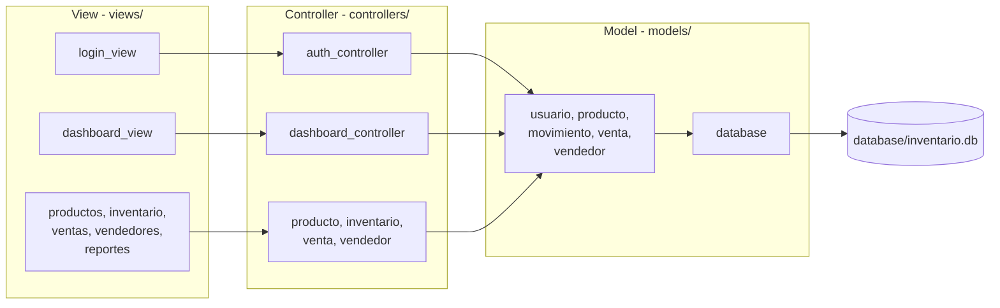
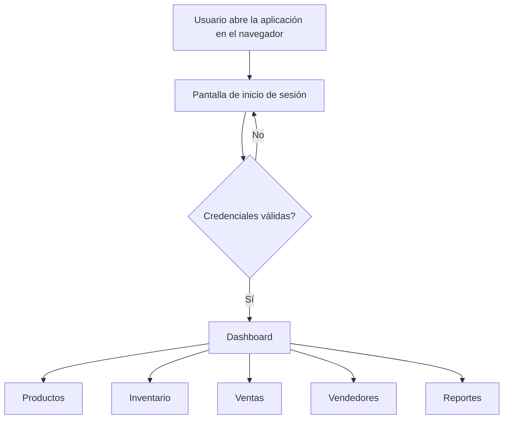

<p align="center">
  
</p>

<h1 align="center">GUMMY ERP</h1>

<p align="center">
  <strong>Python Data System</strong><br>
  Aplicación web académica para gestionar inventario, productos, ventas y vendedores, con análisis de datos y un dashboard.
</p>

<p align="center">
  
  
  
</p>

<p align="center">
  
  
  
  
  
  
  
</p>

---

## Contenido

| | | |
|:---|:---|:---|
| [Descripción](#descripción) | [Tecnologías](#tecnologías) | [Arquitectura MVC](#arquitectura-mvc) |
| [Estructura del proyecto](#estructura-del-proyecto) | [Recursos gráficos](#recursos-gráficos) | [Diseño del login](#diseño-del-login) |
| [Instalación y configuración](#instalación-y-configuración) | [Estado actual](#estado-actual) | [Módulos previstos](#módulos-previstos) |

---

## Descripción

**GUMMY ERP** es una aplicación web académica desarrollada en **Python** con **Flet**. Su propósito es ofrecer un pequeño sistema de gestión empresarial centrado en:

- Control de **inventario** y **movimientos** de stock.
- Gestión de **productos**, **vendedores** y **ventas**.
- **Inicio de sesión** de usuarios.
- **Reportes** y un **dashboard** con indicadores y gráficas.

El proyecto aplica **programación orientada a objetos**, separa responsabilidades con una **arquitectura MVC**, usa **SQLite** como base de datos local y **Pandas** / **Matplotlib** para el análisis y la visualización de datos.

> [!NOTE]
> El proyecto está en su **fase inicial**. La estructura de carpetas y los archivos base ya existen, pero **todavía no hay funcionalidades implementadas**. Consulta [Estado actual](#estado-actual).

---

## Tecnologías

| Tecnología | Versión | Uso en el proyecto |
|:---|:---:|:---|
| Python | 3.12 | Lenguaje principal |
| Flet | 1.1.3 | Interfaz web (vistas) |
| Pandas | 3.1.1 | Procesamiento y análisis de datos |
| Matplotlib | 3.11.2 | Gráficas para reportes y dashboard |
| SQLite (`sqlite3`) | Incluido en Python | Base de datos local |
| bcrypt | 5.0.0 | Hash seguro de contraseñas para el inicio de sesión |
| Git / GitHub | — | Control de versiones y colaboración |

> `sqlite3` forma parte de la biblioteca estándar de Python, por eso no aparece en `requirements.txt`.

---

## Arquitectura MVC

El código se organiza en tres capas con responsabilidades separadas:

| Capa | Carpeta | Responsabilidad |
|:---|:---|:---|
| **Model** | `models/` | Acceso a datos, consultas y persistencia en SQLite |
| **View** | `views/` | Pantallas e interfaz web construidas con Flet |
| **Controller** | `controllers/` | Recibe las acciones de la vista, aplica la lógica y coordina los modelos |

Las vistas no acceden directamente a la base de datos, y los modelos no dependen de la interfaz.



### Flujo general previsto de la aplicación



> Este flujo describe el comportamiento **planificado**. Aún no está implementado.

---

## Estructura del proyecto

Estructura real del repositorio en este momento:

```text
GUMMY ERP/
├── assets/
│   ├── Logo.png                   Logotipo oficial
│   └── imagen-login.png           Fondo de la pantalla de inicio de sesión
├── controllers/
│   ├── auth_controller.py
│   ├── dashboard_controller.py
│   ├── inventario_controller.py
│   ├── producto_controller.py
│   ├── vendedor_controller.py
│   └── venta_controller.py
├── database/
│   └── inventario.db              Base de datos local (no se versiona)
├── models/
│   ├── database.py
│   ├── movimiento_model.py
│   ├── producto_model.py
│   ├── usuario_model.py
│   ├── vendedor_model.py
│   └── venta_model.py
├── views/
│   ├── dashboard_view.py
│   ├── inventario_view.py
│   ├── login_view.py
│   ├── productos_view.py
│   ├── reportes_view.py
│   ├── vendedores_view.py
│   └── ventas_view.py
├── Banner.png                     Banner del proyecto
├── .gitignore
├── README.md
└── requirements.txt
```

| Ruta | Contenido |
|:---|:---|
| `assets/` | Recursos gráficos de la interfaz |
| `controllers/` | Controladores: autenticación, dashboard, inventario, productos, vendedores y ventas |
| `models/` | Conexión a la base de datos y modelos de usuario, producto, movimiento, venta y vendedor |
| `views/` | Vistas Flet: login, dashboard, productos, inventario, ventas, vendedores y reportes |
| `database/` | Archivo SQLite local de desarrollo |

> El entorno virtual (`venv/`) y la base de datos local (`*.db`) están excluidos del repositorio mediante `.gitignore`.

---

## Recursos gráficos

| Recurso | Ruta | Uso |
|:---|:---|:---|
| Logotipo oficial | [`assets/Logo.png`](assets/Logo.png) | Identidad del proyecto, cabecera de este README y de la aplicación |
| Fondo del login | [`assets/imagen-login.png`](assets/imagen-login.png) | Imagen de fondo de la pantalla de inicio de sesión |
| Banner | [`Banner.png`](Banner.png) | Banner promocional del proyecto |

<p align="center">
  
</p>

---

## Diseño del login

La pantalla de inicio de sesión (`views/login_view.py`) está **diseñada pero pendiente de implementar**. El diseño previsto es:

- La imagen [`assets/imagen-login.png`](assets/imagen-login.png) ocupa **toda la pantalla como fondo**.
- El **formulario de acceso** se ubica en el **lado derecho** de la pantalla, sobre el fondo.
- El formulario contendrá usuario, contraseña y botón de ingreso.
- Las contraseñas se verificarán con **bcrypt** a través de `controllers/auth_controller.py` y `models/usuario_model.py`.

```text
+--------------------------------------------------------------+
|                                          +----------------+  |
|                                          |   GUMMY ERP    |  |
|        Imagen de fondo                    |                |  |
|        assets/imagen-login.png            |  Usuario       |  |
|                                          |  [__________]  |  |
|                                          |  Contraseña    |  |
|                                          |  [__________]  |  |
|                                          |                |  |
|                                          |  [ Ingresar ]  |  |
|                                          +----------------+  |
+--------------------------------------------------------------+
```

<p align="center">
  
</p>

---

## Instalación y configuración

**Requisitos:** Python 3.12 y Git.

**1. Clonar el repositorio**

```bash
git clone <URL-del-repositorio>
cd "GUMMY ERP"
```

**2. Crear el entorno virtual**

```bash
python -m venv venv
```

**3. Activar el entorno virtual**

| Sistema | Comando |
|:---|:---|
| Windows (PowerShell) | `venv\Scripts\Activate.ps1` |
| Windows (CMD) | `venv\Scripts\activate.bat` |
| Linux / macOS | `source venv/bin/activate` |

**4. Instalar las dependencias**

```bash
pip install -r requirements.txt
```

**5. Ejecutar la aplicación**

> [!IMPORTANT]
> Todavía **no existe un punto de entrada** (`main.py`). Las instrucciones de ejecución se añadirán cuando se implemente. Con Flet, la ejecución en modo web será del tipo `flet run --web <archivo_principal>.py`.

---

## Estado actual

| Elemento | Estado |
|:---|:---:|
| Estructura de carpetas MVC | Completado |
| Archivos base de modelos, vistas y controladores | Creados, vacíos |
| Entorno virtual y dependencias | Completado |
| Logotipo e imagen de fondo del login | Incorporados |
| Documentación inicial (README) | Completado |
| Punto de entrada de la aplicación (`main.py`) | Pendiente |
| Esquema de la base de datos SQLite | Pendiente |
| Pantalla de inicio de sesión | Pendiente |
| Resto de módulos | Pendiente |

---

## Módulos previstos

Ninguno de estos módulos está implementado todavía. Los archivos correspondientes existen como base vacía.

| Módulo | Vista | Controlador | Modelo | Estado |
|:---|:---|:---|:---|:---:|
| Inicio de sesión | `login_view.py` | `auth_controller.py` | `usuario_model.py` | Pendiente |
| Dashboard | `dashboard_view.py` | `dashboard_controller.py` | — | Pendiente |
| Productos | `productos_view.py` | `producto_controller.py` | `producto_model.py` | Pendiente |
| Inventario y movimientos | `inventario_view.py` | `inventario_controller.py` | `movimiento_model.py` | Pendiente |
| Ventas | `ventas_view.py` | `venta_controller.py` | `venta_model.py` | Pendiente |
| Vendedores | `vendedores_view.py` | `vendedor_controller.py` | `vendedor_model.py` | Pendiente |
| Reportes | `reportes_view.py` | — | — | Pendiente |
| Conexión a base de datos | — | — | `database.py` | Pendiente |

### Hoja de ruta

- [x] Estructura de carpetas MVC
- [x] Entorno virtual y dependencias
- [x] Recursos gráficos (logotipo y fondo del login)
- [ ] Punto de entrada de la aplicación
- [ ] Esquema y conexión de la base de datos SQLite
- [ ] Inicio de sesión con contraseñas cifradas
- [ ] Gestión de productos, inventario, ventas y vendedores
- [ ] Dashboard con indicadores y gráficas
- [ ] Reportes
- [ ] Pruebas y documentación final

---

<p align="center">
  <strong>GUMMY ERP</strong> · Equipo JOJO CEVIA · 2026<br>
  <sub>Proyecto académico</sub>
</p>

